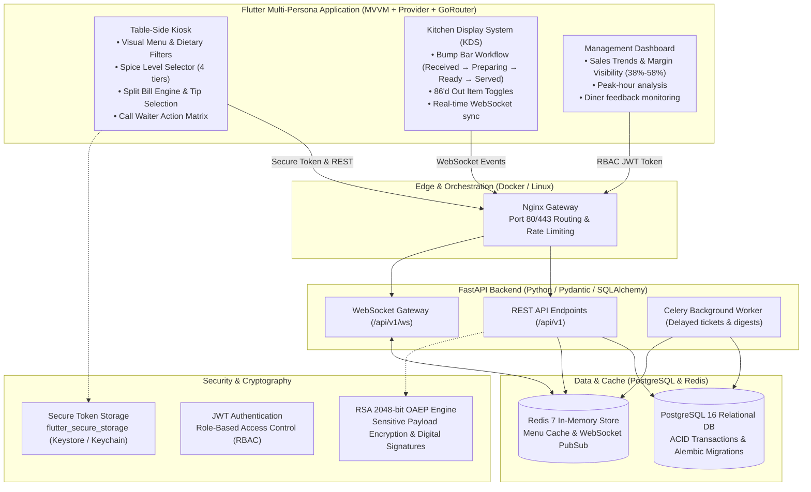
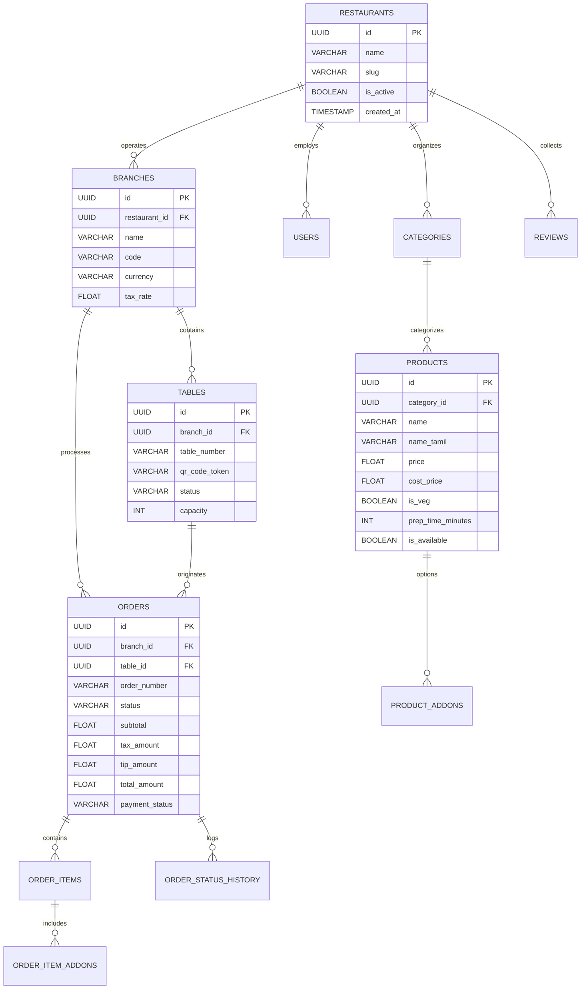

# OrderEase: Smart Table-Side Self-Ordering Kiosk & Restaurant Management Platform

[](https://github.com/maniananthgit/smart-kiosk-demo/actions/workflows/ci.yml)
[](https://flutter.dev)
[](https://fastapi.tiangolo.com)
[](https://www.sqlalchemy.org)
[](https://www.postgresql.org)
[](https://redis.io)
[](https://docs.celeryq.dev)
[](https://www.docker.com)

---

## 1. System Technology Stack

OrderEase operates strictly with the following verified enterprise technology stack:

| Layer | Technologies & Frameworks | Description |
| :--- | :--- | :--- |
| **Frontend** | **Flutter**, **Dart**, **Provider**, **MVVM architecture**, **GoRouter** | Cross-platform kiosk client supporting Customer Table Ordering, Kitchen Display System (KDS), and Restaurant Management Dashboard with reactive state separation and declarative URL routing. |
| **Backend** | **Python 3.11+**, **FastAPI**, **Pydantic v2**, **SQLAlchemy 2.0** | High-concurrency asynchronous REST & WebSocket API, strict input serialization/validation, and async ORM mapping. |
| **Database** | **PostgreSQL 16** | ACID-compliant relational persistence with Alembic migration version control and connection pooling. |
| **Security** | **JWT authentication**, **RSA encryption (2048-bit RSA-OAEP-256)**, **Secure token storage** | Asymmetric RSA key pair management for sensitive payload encryption and signatures; JWT access/refresh token pairs; hardware-backed keystore/keychain storage via `flutter_secure_storage`. |
| **Infrastructure** | **Redis 7**, **Celery**, **Docker**, **Docker Compose**, **Linux**, **Git & GitHub**, **GitHub Actions** | Low-latency caching & pub/sub event bus; async background jobs for ticket monitoring & digests; multi-container Linux orchestration; full CI/CD test automation. |
| **Testing** | **pytest**, **Flutter testing** | 100% automated test coverage spanning backend unit/model/security/API tests via `pytest` and Flutter unit/ViewModel/widget tests via `flutter_test`. |

---

## 2. System Architecture



---

## 3. Database Schema (PostgreSQL 16)



---

## 4. Frontend MVVM Architecture (Flutter & Provider)

The Flutter frontend is engineered using the **Model-View-ViewModel (MVVM)** pattern with **Provider** for clean reactive dependency injection:

- **Models (`lib/data/models/`)**:
  - `ProductModel`: Menu item with multi-language strings, dietary tags, allergens, and spice indicators.
  - `OrderModel`: Order items, add-on customizations, prep notes, payment method, tip, and split billing details.
  - `TableSessionModel`: Active table authentication, table number, and order history.
  - `DashboardSummaryModel`: Gross revenue, orders count, margin percentages, and hourly rush metrics.

- **ViewModels (`lib/features/*/viewmodels/`)**:
  - `CustomerOrderViewModel`: Handles dish browsing, category tabs, dietary veg/non-veg filter, reactive cart additions, spice level changes, split bill distribution, tip percentage calculation, and checkout order submission.
  - `KitchenViewModel`: Manages live ticket feeds, status bump transitions (`RECEIVED` → `PREPARING` → `READY` → `SERVED`), and 86'd menu availability toggles.
  - `ManagementViewModel`: Fetches real-time dashboard analytics, hourly orders, and menu gross profit margins.

- **Views (`lib/features/*/views/`)**:
  - `TableKioskView`: Touch-optimized self-ordering screen (8" to 12" restaurant tablets).
  - `KitchenDisplayView`: Kitchen bump display with color-coded ticket aging and status controls.
  - `ManagementView`: Operational analytics dashboard with visual KPIs.
  - `LandingHubView`: Station persona switcher for quick multi-terminal demonstration.

- **Routing (`lib/core/routing/app_router.dart`)**:
  - Declarative routes powered by `GoRouter`:
    - `/` → Presentation Hub & Station Selector
    - `/kiosk` → Table-Side Kiosk
    - `/kitchen` → Kitchen Display System (KDS)
    - `/management` → Management & Analytics Dashboard

- **Secure Token Storage (`lib/data/services/storage_service.dart`)**:
  - Powered by `flutter_secure_storage` with hardware encryption (Android Keystore / iOS Keychain) and Web fallback for JWT access and refresh tokens.

---

## 5. Security & Cryptography

### Asymmetric RSA Cryptography (RSA-OAEP-256)
- **Key Generation**: 2048-bit RSA key pair dynamically initialized via Python `cryptography` primitives (`RSAKeyManager`).
- **Public Key Endpoint**: `GET /api/v1/auth/public-key` exports the public key in standard PEM X.509 format for client terminals.
- **Payload Encryption**: Sensitive checkout payloads, customer contact data, and payment verification tokens are encrypted with `RSA-OAEP (SHA-256)` on the client before network transit.
- **Digital Signatures**: Digital signing using `SHA256-with-RSA` for authenticating ticket origin and table dispatch events.

### JWT Authentication
- Role-based Access Control (RBAC) with short-lived access tokens (`ACCESS_TOKEN_EXPIRE_MINUTES`) and refresh tokens (`REFRESH_TOKEN_EXPIRE_DAYS`).
- Token validation middleware protecting management and kitchen dispatch endpoints.

---

## 6. Docker & Local Execution

### Prerequisites
- Docker Engine 24+ & Docker Compose v2+
- Python 3.11+ (for local CLI / test execution)
- Flutter 3.35+ (for local frontend build)

### Start Full Stack Locally with Docker Compose
```bash
# Clone the repository
git clone https://github.com/maniananthgit/smart-kiosk-demo.git
cd smart-kiosk-demo/Demo_kiosk

# Start PostgreSQL, Redis, FastAPI Backend, Celery Worker, and Flutter Web Nginx
docker compose up -d --build

# Verify running containers
docker compose ps
```

Services exposed:
- **Web App (Landing Hub / Kiosk / KDS / Manager)**: [http://localhost](http://localhost)
- **FastAPI Interactive Docs (Swagger)**: [http://localhost/api/v1/docs](http://localhost/api/v1/docs)
- **PostgreSQL Database**: `localhost:5432`
- **Redis Cache & PubSub**: `localhost:6379`

---

## 7. Automated Testing

### Backend Testing (pytest)
```bash
cd backend

# Run complete test suite (Auth, RSA Cryptography, PostgreSQL Models, Menu, Orders)
pytest -v --asyncio-mode=auto
```

### Frontend Testing (Flutter testing)
```bash
cd frontend

# Run Flutter ViewModel, unit, and widget test suites
flutter test --reporter expanded
```

---

## 8. Continuous Integration (GitHub Actions)

The `.github/workflows/ci.yml` pipeline triggers automatically on commits and pull requests:
1. **Backend Job**: Boots PostgreSQL 16 & Redis 7 service containers, executes Alembic migrations, and runs all `pytest` suites.
2. **Frontend Job**: Sets up Flutter 3.35, validates code formatting with `flutter analyze`, and executes unit/widget tests via `flutter test`.
3. **Docker Verification**: Verifies Docker Compose container specifications build cleanly on Linux containers.

---

## 9. Global Live Deployment

- **Global Live Kiosk & Management URL**: [https://pulseorder-app.web.app](https://pulseorder-app.web.app)
- **Containerized Orchestration**: Linux & Docker Compose multi-service deployment (`docker-compose up --build -d`).
